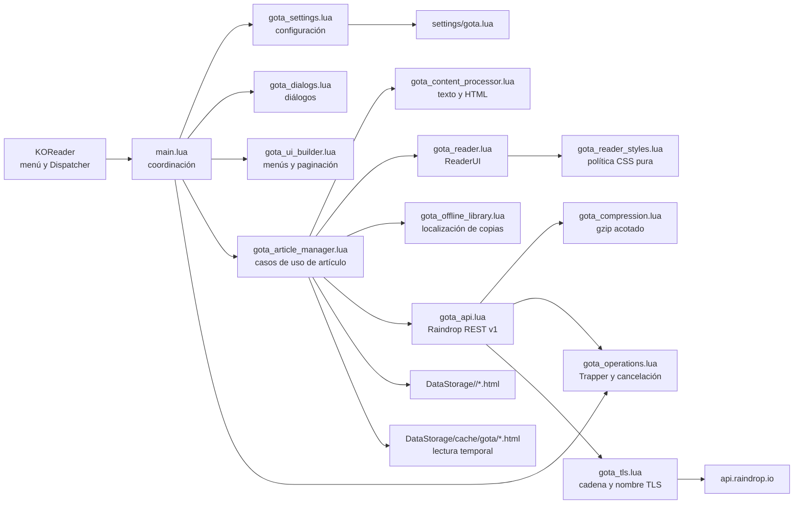
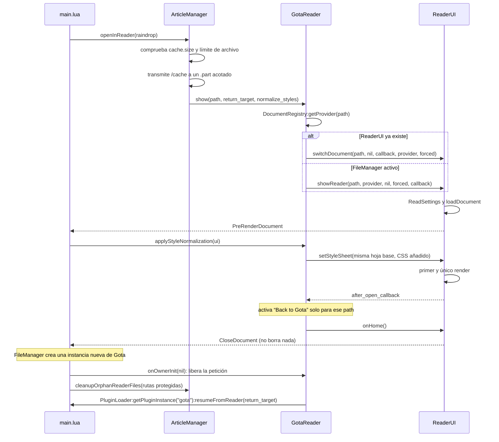

# Arquitectura de Gota

Este documento describe Gota 2.3.0 con las mejoras pendientes de publicación. La referencia es KOReader 2026.07.1 o posterior. La revisión del 30 de septiembre de 2026 contrastó la release estable (`9192014d8bd82a91dc1012473be0f238dedfdb54`), desarrollo (`b539d24b97e52845841af6d7bb521cbba64e34dd`) y la API REST v1 de Raindrop.io.

## Alcance

Gota es un plugin de KOReader para una cuenta personal de Raindrop.io. Permite navegar grupos y colecciones, buscar por alcance, revisar resaltados globales, consultar metadatos, editar campos reversibles y abrir o exportar la copia permanente de un artículo.

La autenticación implementada es mediante un token pegado por el usuario. No existe flujo OAuth ni renovación de tokens. La copia permanente de artículos requiere Raindrop PRO; las notas y los resaltados no.

## Componentes



| Módulo | Responsabilidad | No debe hacer |
|---|---|---|
| `main.lua` | Componer dependencias, registrar menú/Dispatcher y coordinar pantallas | Interpretar HTTP o transformar HTML |
| `gota_api.lua` | Transporte HTTPS, autenticación, redirects, reintentos, caché de respuestas y endpoints | Construir widgets |
| `gota_operations.lua` | Ejecutar red en subprocess mediante Trapper, cancelar el flujo completo y rechazar respuestas de una sesión anterior | Crear pantallas de navegación o persistir datos de cuenta |
| `gota_tls.lua` | Verificar cadena y SAN del servidor antes de enviar HTTP; aplicar la política por petición | Cambiar opciones globales de LuaSec |
| `gota_gettext.lua` | Cargar el catálogo del plugin con fallback regional, conservando los diccionarios de KOReader | Cambiar el dominio global de traducción |
| `gota_raindrop.lua` | Normalizar referencias numéricas y objetos de resaltados | Hacer red o construir widgets |
| `gota_compression.lua` | Descomprimir gzip mediante el zlib incluido en KOReader y limitar la salida | Hacer red o ejecutar comandos externos |
| `gota_article_manager.lua` | Cargar, recargar, exportar y abrir artículos | Conocer internals de `ReaderUI` |
| `gota_content_processor.lua` | Sanear UTF-8, convertir HTML a texto y generar documentos locales | Hacer red |
| `gota_reader.lua` | Abrir/cambiar documento, volver a Gota mediante APIs públicas de KOReader y aplicar la hoja transitoria en pre-render | Preabrir documentos, modificar tablas internas del menú o mutar ajustes persistentes |
| `gota_reader_styles.lua` | Componer el CSS de presentación y detectar los tweaks oficiales de tamaño | Requerir módulos de KOReader, tocar disco o guardar estado |
| `gota_offline_library.lua` | Nombrar, localizar y enumerar copias offline; leer títulos acotados y progreso | Descargar, escribir archivos o requerir módulos de KOReader |
| `gota_ui_builder.lua` | Crear items, jerarquías de colecciones y paginación | Hacer red o persistir configuración |
| `gota_dialogs.lua` | Construir diálogos y recoger entradas | Guardar directamente ajustes |
| `gota_settings.lua` | Leer y escribir `gota.lua` mediante `LuaSettings` | Registrar UI |
| `gota_version.lua` | Versión, User-Agent y objetivo KOReader | Contener lógica de ejecución |

## Navegación y coherencia de pantalla

Cada detalle de artículo recibe un `SourceContext` pequeño con `kind`, página remota y una función `reload(focus_raindrop_id)`. La closure captura solo IDs, nombre, término, filtros normalizados y alcance; no conserva envelopes, HTML ni widgets. Tras editar favorito, nota, etiquetas o colección, el proceso padre adopta la respuesta, cierra el detalle y reconstruye la lista autoritativa. Las filas llevan `gota_raindrop_id`, y `Menu:switchItemTable` localiza su página sin escribir campos internos de KOReader. En un `Menu` normal KOReader solo restaura la página: el foco exacto del D-pad sobre la fila no está garantizado (la estable lo restaura únicamente cuando el menú tiene `path`, como FileChooser). Mover a Papelera recarga sin foco porque el elemento ya no debe aparecer en el origen. Si una mutación vacía la última página remota (mover su único elemento), la lista recarga la última página que aún tiene elementos.

Cada `SourceContext` incluye además un `descriptor` de datos planos (`kind`, IDs, nombre, término, filtros, página). Es lo que sobrevive al lector: KOReader sustituye la instancia del plugin al abrir y cerrar `ReaderUI`, así que el retorno no puede capturar `self`.

Las colecciones informan `access.level` (1–2 solo lectura, 3 escritura, 4 propietario). Gota recuerda ese nivel por proceso al cargar la estructura y lo olvida al cambiar de cuenta. En una colección compartida de solo lectura el detalle no ofrece favorito, nota, etiquetas, mover ni Papelera, y el selector de destino atenúa y deshabilita esas colecciones. Si el nivel es desconocido (el artículo se abrió desde una búsqueda antes de cargar colecciones, o la respuesta no trae `access`) se ofrecen todas las acciones y decide el servidor; un 403 se explica como falta de permiso.

Las instancias de FileManager y ReaderUI comparten token, generación de sesión y preferencias TLS. Guardar o borrar un token invalida las respuestas y la navegación de la cuenta; los callbacks capturan la generación al crearse. Una respuesta o acción de una generación anterior se descarta, incluso si otra entrada ya actualizó la pantalla. La validación de un token candidato usa una instancia API independiente.

Las listas remotas mantienen 25 elementos por petición. Sus controles aparecen arriba y abajo para no confundirse con la paginación interna de `Menu`; el subtítulo muestra alcance, filtros, rango y página de Raindrop. La búsqueda avanzada conserva su último estado únicamente durante el proceso (`last_advanced_search`) y no lo escribe en `gota.lua`.

## Ciclo de vida en KOReader

`Gota:init()` registra primero las acciones de Dispatcher, instancia las dependencias, declara su archivo de ajustes y se registra en el menú principal. `is_doc_only = false` permite que el mismo plugin esté disponible en FileManager y ReaderUI.

Las tres acciones de Dispatcher son:

- `gota_show_articles` → `GotaShowArticles`;
- `gota_search` → `GotaSearch`;
- `gota_collections` → `GotaShowCollections`.

El menú usa `registerToMainMenu`/`addToMainMenu` sin `sorting_hint`, de modo que KOReader conserva la ubicación de nivel superior que Gota ha tenido siempre (lo fija una prueba). Gota no escribe en `reader.menu.menu_table`.

### Apertura y retorno del lector



`DocumentRegistry:getProvider` solo selecciona el proveedor. `ReaderUI` conserva la propiedad exclusiva de abrir y cerrar el documento; Gota no llama `DocumentRegistry:openDocument` por anticipado.

`CloseDocument` no distingue una recarga nativa de una salida: `ReaderUI:reloadDocument` lo emite y después reabre la misma ruta en una `ReaderUI` nueva. Por eso Gota nunca borra al recibirlo. Cada instancia nueva del plugin —una por FileManager y otra por ReaderUI— llama primero a `GotaReader:onOwnerInit(documento_activo)`, que libera la petición pendiente (retorno, normalización) solo si el nuevo propietario muestra otro documento y `ReaderUI` ya no conserva el pedido. Después limpia los temporales que no estén protegidos: el documento propio, la petición pendiente y lo que `ReaderUI.instance` tenga abierto. Así, una recarga conserva archivo, «Back to Gota» y normalización; Home o abrir otro libro retiran el temporal, y un cierre forzado lo deja hasta la siguiente inicialización de Gota.

«Back to Gota» guarda un `return_target` de datos planos —vista, instantánea del artículo sin el texto cargado, `descriptor` de origen y generación de cuenta— y, tras `onHome`, lo resuelve contra la instancia viva con `PluginLoader:getPluginInstance("gota")`. Si la cuenta cambió mientras se leía, no reabre el artículo antiguo. «Abrir carpeta» tras guardar sigue el mismo orden que `ReaderUI:onHome`: cierra el lector y después muestra el gestor con el archivo enfocado, sin dejar un lector vivo debajo.

### Normalización tipográfica del full reader

Las copias web conservan el CSS editorial del sitio, y la hoja base de KOReader asigna 150 %–100 % a `h1`–`h6`, 80 % a `table` y 70 % a `sub`/`sup`. Una página que marca sus citas como `h5` acaba mostrándolas mucho mayores que su propia prosa. Gota acota esa jerarquía con una hoja de presentación transitoria.

`ReaderUI` emite `PreRenderDocument` después de `loadDocument()` y antes de `document:render()`. En ese punto `ReaderTypeset:onReadSettings` ya resolvió la hoja base y los tweaks activos, así que instalar CSS no provoca un segundo render. `CreDocument:setStyleSheet(hoja_base, css_añadido)` recarga la misma hoja base y concatena el string después de ella; el binding de CREngine hace esa concatenación sin copiar el HTML.

Contratos de esta etapa:

| Contrato | Comportamiento |
|---|---|
| Archivo | El HTML temporal sigue siendo el recibido de Raindrop. No se genera una copia normalizada ni se reescribe el original. |
| Memoria | Un string CSS de pocos KiB, independiente del tamaño del documento. La ruta no lee el archivo ni usa `read("*all")`. |
| Persistencia | Nada se guarda en `doc_settings`, `configurable` ni `G_reader_settings`. La intención vive en el singleton de proceso y `reset()` la borra. |
| Alcance | Solo el documento cuyo path coincide con la petición activa de Gota. Libros ajenos, el documento saliente de `switchDocument` y el HTML reabierto desde historial quedan intactos. |
| Estilos incrustados | `embedded_css` no se toca; Gota nunca llama `setEmbeddedStyleSheet`. |
| Fallo | Un API ausente o que lanza deja abrir el artículo con un warning técnico sin contenido del artículo. |

La precedencia inicial es: hoja base de KOReader → CSS transitorio de Gota → Style tweaks del usuario → cascada del CSS editorial. Hay dos excepciones deliberadas. Si `font_size_all_inherit` o `font_size_most_reset` ya están activos, Gota omite su bloque tipográfico y solo conserva limpieza y ajuste de imágenes: el usuario ya eligió una política de tamaños. Y si durante la lectura cambia los Style tweaks, `ReaderTypeset:onApplyStyleSheet` reconstruye la hoja con sus ajustes; Gota no intercepta ese evento ni reimpone su escala.

La escala usa `rem` como los tweaks oficiales, de modo que cuerpo, títulos, tabla y código escalan juntos al cambiar el tamaño base.

Esta etapa **no es un saneamiento**. `display:none` solo evita que CREngine presente etiquetas interactivas o no presentables; el HTML remoto sigue en el archivo y sigue siendo contenido no confiable. `header`, `footer`, `aside`, `figure`, `svg`, tablas, listas, `pre` y `code` permanecen visibles porque suelen contener texto editorial. El chrome basado en `div` y clases del sitio no se detecta: para extracción real, la vista de texto plano es la ruta prevista. La copia original y la vista de texto plano no pasan por esta política.

## Transporte y contrato Raindrop

La URL base es `https://api.raindrop.io/rest/v1`. El constructor rechaza HTTP, credenciales embebidas, query o fragmento en la URL base. Raindrop no ofrece un endpoint HTTP, por lo que HTTPS sigue siendo obligatorio como transporte.

La verificación HTTPS está activada por defecto. `gota_tls.lua` usa `verify = "peer"` con el bundle CA de KOReader (`data/ca-bundle.crt`) o un almacén del sistema y comprueba el SAN del certificado después del handshake, antes de enviar la línea HTTP o el Bearer token. Se exige SAN: no existe fallback al common name, y un wildcard solo cubre una etiqueta DNS. Una IP literal IPv4 exige IP SAN; IPv6 literal no está soportado. Si falta el almacén o la capacidad necesaria, la petición falla. No se modifica la política global de LuaSec.

La configuración ofrece desactivar la verificación de forma explícita y con confirmación por compatibilidad del dispositivo. Ese modo conserva el cifrado, pero permite suplantar al servidor. `tls_ca_file` admite un almacén CA personalizado en los ajustes. La información de diagnóstico distingue la política disponible de `validation_observed`, que solo se activa después de una conexión verificada.

Cada llamada inicial incluye `Authorization: Bearer <token>`. Gota solicita `Accept-Encoding: identity`, pero algunos hosts de almacenamiento devuelven gzip de todos modos. En ese caso usa el zlib incluido en KOReader: no ejecuta binarios externos y aplica el límite configurado a los bytes ya descomprimidos. Una codificación diferente, como Brotli, se rechaza por nombre.

### Copia permanente y redirect

`GET /raindrop/{id}/cache` puede responder 307. Gota desactiva el seguimiento automático y aplica este flujo:

1. acepta redirects solo durante la descarga de caché;
2. exige una URL absoluta HTTPS sin credenciales;
3. limita la cadena a tres redirects;
4. no reenvía `Authorization` al host de almacenamiento;
5. acepta el HTML únicamente tras una respuesta 2xx final.

### Errores y reintentos

`JSON.decode` está protegido con `pcall` y usa `JSON.decode.simple`: luajson representa `null` con una función centinela, que el `string.buffer` de Trapper no puede serializar de vuelta desde el worker. Los bodies JSON de error aportan `errorMessage`, `message` o `error.message` cuando existen. Los timeouts de `socketutil` se restauran incluso si LuaSec lanza una excepción.

Solo las lecturas `GET`/`HEAD` reintentan errores de transporte, 429 y 5xx, hasta tres intentos. `POST`, `PUT`, `PATCH` y `DELETE` hacen exactamente un intento. El retraso es exponencial y, para 429, calcula `X-RateLimit-Reset` (epoch UTC documentado) o `Retry-After` si llega, aunque no forma parte del contrato publicado. El retraso por intento sigue limitado a tres segundos; si el servidor pide más, solicita reintentar más tarde. Los demás 4xx no se reintentan sin modificar la petición.

Tras un 429 el worker devuelve al proceso padre el instante permitido —el estado del subprocess se descarta— y el padre rechaza nuevas peticiones de ese token, lecturas y escrituras, sin abrir otro worker hasta que pasa. El mensaje muestra la espera real. La espera se acota a 120 s (dos ventanas de un minuto de Raindrop) porque los e-readers despiertan a menudo con el reloj atrasado y el epoch de reset parecería estar a horas; si el reloj retrocede, el bloqueo se descarta. Validar otro token no queda bloqueado y cambiar de cuenta lo limpia.

Una respuesta 2xx de `/raindrop/{id}/cache` que sea el envelope de error documentado (`{"result": false, …}`) se trata como error y no se guarda como artículo.

Todas las entradas de red de la UI ejecutan el flujo completo dentro de una coroutine de `Trapper`. El ejecutor mueve transporte, reintentos, descompresión y JSON a `dismissableRunInSubprocess`; el padre conserva widgets, navegación y caché. Solo la coroutine propietaria puede anidar llamadas, y un bloqueo de proceso impide operaciones simultáneas entre instancias. Cancelar aborta también endpoints opcionales y fallback de datos. Las descargas canceladas retiran `.part` y `.part.decoded`. Si se interrumpe una escritura, Gota invalida la caché y explica que el servidor puede haberla guardado; no vuelve a enviarla automáticamente.

JSON está limitado a 2 MiB recibidos y descomprimidos. La caché GET tiene TTL de cinco minutos, un máximo de 32 entradas y 4 MiB estimados de claves y estructuras Lua; elimina caducados y expulsa las entradas menos utilizadas. No es un límite exacto del heap. `getRaindrop(id, true)` fuerza la recarga. Cualquier resultado de escritura, incluido un fallo incierto, invalida la caché.

### Endpoints usados

| Caso de uso | Endpoint |
|---|---|
| Usuario autenticado | `GET /user` |
| Estadísticas del usuario | `GET /user/stats` |
| Colecciones raíz | `GET /collections` |
| Colecciones hijas | `GET /collections/childrens` |
| Marcadores | `GET /raindrops/{collectionId}` |
| Marcador completo | `GET /raindrop/{id}` |
| HTML permanente | `GET /raindrop/{id}/cache` |
| Filtros | `GET /filters/{collectionId}` |
| Resaltados globales/por colección | `GET /highlights[/{collectionId}]` |
| Favorito, nota, tags y colección | `PUT /raindrop/{id}` |
| Mover a Trash, solo fuera de Trash | `PUT /raindrop/{id}` con `collection.$id = -99` |
| Todos los tags | `GET /tags` |
| Tags de una colección | `GET /tags/{collectionId}` |

La búsqueda avanzada construye un único parámetro `search`. Por ejemplo, texto `swift`, tag `coffee beans` y tipo `article` producen `swift #"coffee beans" type:article` antes del URL encoding. La búsqueda textual usa `sort=score`; una consulta que solo contiene filtros usa el orden configurado, cuyo valor inicial es `-created`. El subtítulo muestra ese mismo orden efectivo. El paso a Papelera siempre expresa el destino mediante `PUT`, así que una copia local desactualizada no puede provocar el borrado definitivo que Raindrop permite mediante `DELETE` en Papelera. Los resaltados aceptan el `raindropRef` numérico documentado y la variante objeto. El alcance puede ser global, una colección o una colección con `nested=true`. `/filters/{id}?tagsSort=-count` es la única fuente de los filtros populares.

## Modelo de caché de artículo

Raindrop separa los metadatos de caché del HTML. Gota refleja esa separación:

| Estado local | Significado | Acciones de lectura |
|---|---|---|
| `metadata_available` | `cache.status == "ready"` | habilita acciones que descargan bajo demanda |
| `html_loaded` | existe `cache.text` no vacío y acotado | permite transformar a texto o HTML enriquecido |
| `download_error` | falló, excedió el límite o llegó vacío | exige recarga/acción explícita |

Abrir el menú o recargar obtiene solo metadatos. La vista de texto descarga en memoria con presets de 2–64 MiB; una instalación nueva comienza en 16 MiB. El lector y «Guardar copia original» transmiten directamente a archivo con presets de 16–512 MiB y un valor inicial de 128 MiB, sin cargar antes el cuerpo completo en RAM. Los valores guardados de versiones anteriores siguen siendo válidos. `cache.size` permite rechazo anticipado y el sink LTN12 aborta si el cuerpo recibido cruza el límite. Cuando la respuesta es gzip, el mismo límite vuelve a comprobarse contra la salida descomprimida. Cada archivo usa `.part`; la variante comprimida y la decodificada se eliminan ante cualquier error, y el archivo final solo aparece después del 2xx y del renombrado atómico. «Exportar con notas y resaltados» no depende del HTML PRO.

### Pipeline de texto plano

La vista de texto valida UTF-8 y usa un scanner iterativo que reconoce etiquetas y atributos entrecomillados. Elimina `script`, `style`, `template`, `svg`, `iframe`, `object`, comentarios y navegación conocida; conserva los `header` editoriales. Elige el `article` con más texto visible o, si no existe, el `main` con más texto visible. La selección no depende del porcentaje que ocupe dentro del documento.

La conversión separa elementos de listas, conserva numeración de `ol`, celdas y filas de tabla y mantiene espacios y líneas vacías en `pre` y `code`. El estado de listas está limitado a 64 niveles y no hay recursión según la profundidad remota. Un documento UTF-8 válido se devuelve sin crear una tabla por carácter; los reemplazos inválidos se agrupan en fragmentos acotados.

El saneamiento ocurre antes de decodificar entidades. Por eso un ejemplo editorial escrito como `&lt;style&gt;` permanece como texto y el contenido de `pre` y `code` no se descarta. El lector HTML y la copia original no pasan por este pipeline. Los límites de 2–64 MiB tampoco cambian: se aplican al HTML descargado y descomprimido antes de convertirlo.

### Frontera de confianza de los exports

La copia original conserva byte a byte el HTML servido por Raindrop y puede contener código o recursos del sitio; se guarda para fidelidad y debe tratarse como contenido web no confiable. El export anotado pertenece a Gota: elimina elementos activos conocidos, convierte el cuerpo remoto a texto, valida UTF-8 y escapa el resultado antes de insertarlo en una plantilla controlada. Las exportaciones nuevas incluyen el marcador `Gota annotated export`, que permite distinguirlas sin depender del título. Notas, resaltados, metadatos y URL también se insertan como texto escapado; la URL no se convierte en `href`. Este segundo formato prioriza seguridad y legibilidad sobre fidelidad visual.

## Colecciones

`API:getCollectionStructure()` conserva por separado `user.groups`, raíces e hijas. El builder ordena grupos por `sort` ascendente, respeta el orden exacto de raíces de cada grupo y ordena hermanos hijos por `sort` descendente. Los nodos no agrupados, huérfanos o involucrados en ciclos se conservan en “Other collections”. El colapso de grupo es local a la sesión. Si usuario o hijos fallan, las raíces siguen disponibles. `/user/stats` añade recuentos de All, Unsorted y Trash e información no accionable de enlaces rotos/duplicados.

Los IDs de sistema usados por la UI son `0` para todos los marcadores, `-1` para Unsorted y `-99` para Trash.

## Persistencia y seguridad

| Dato | Ubicación | Duración |
|---|---|---|
| Token, política TLS, carpeta, orden y límites de caché | `DataStorage:getSettingsDir()/gota.lua` | persistente; el token puede borrarse desde Gota. En memoria es estado de sesión compartido por todas las instancias, y cada guardado relee el archivo antes de confirmar |
| HTML exportado | `DataStorage:getDataDir()/<download_path>/` | persistente |
| HTML usado por ReaderUI | `DataStorage:getDataDir()/cache/gota/` | temporal; la siguiente instancia de Gota cuyo propietario muestra otro documento retira solo `raindrop_<id>.html`, `.part` y `.part.decoded` no protegidos |
| Respuestas API | tabla de `API.response_cache` | sesión, TTL 5 min, 32 entradas y 4 MiB estimados |
| Estado de retorno del lector | singleton `GotaReader` (`return_target` de datos planos) | proceso; sobrevive a recargas nativas |
| Niveles de acceso de colecciones y bloqueo por 429 | módulos `main.lua` y `gota_api.lua` | proceso; se limpian al cambiar de cuenta |

Cada módulo usa `gota_gettext`, que carga `l10n/<idioma>/gota.mo` en diccionarios temporales y restaura traducciones, contextos y regla de plurales de KOReader. Un idioma regional puede usar el catálogo base, por ejemplo `es_ES` → `es`.

El diálogo muestra el token como contraseña, pero `LuaSettings` lo guarda en texto claro. El archivo debe tratarse como una credencial y no compartirse en informes, respaldos públicos o issues. El alcance soportado es una integración personal mediante test token; OAuth multiusuario queda fuera del diseño actual.

La allowlist de limpieza exige el directorio canónico y el nombre exacto. Nunca borra exports, otros archivos de caché ni directorios `.sdr`; los sidecars de lectura se conservan. La carpeta de exportación siempre queda bajo `DataStorage`, acepta espacios y segmentos anidados y rechaza rutas absolutas, `.`/`..`, controles y escapes mediante symlink.

El ajuste `download_path` conserva su clave en `gota.lua` por compatibilidad, pero la UI lo llama «carpeta de exportación» porque solo gobierna «Descargar para leer sin conexión» y «Exportar con notas y resaltados». El lector completo escribe en `cache/gota/` y retira su archivo cuando el lector pasa a otro documento o al gestor, de modo que abrir un artículo nunca sobrescribe una copia guardada a propósito. La UI evita el verbo «descargar» en esa acción para no prometer un archivo persistente.

### Lectura offline y reanudación

KOReader guarda la posición de lectura en un sidecar cuya ubicación depende del ajuste `document_metadata_folder`. Con los valores `doc` (por defecto) y `dir` la clave es la **ruta** del documento; con `hash` es el `partialMD5` del **contenido**. Por eso la copia offline usa un nombre determinista `<id>_<título>.html` sin el contador de colisiones que `getUniqueFilename` aplica al resto de exportaciones, y una descarga repetida sobrescribe en el sitio en lugar de acumular duplicados.

En modo `hash` la ruta estable no basta por sí sola, pero la reanudación se conserva igualmente porque el archivo web de Raindrop se genera una sola vez —no existe re-archivado, solo borrar y volver a guardar, lo que produce un `_id` distinto— y porque `partialMD5` muestrea unos 12 KiB en offsets fijos. La ruta estable sigue siendo necesaria: es la única clave en los modos `doc` y `dir`, que son los predeterminados.

Antes de sobrescribir se comprueba que el documento no esté abierto en `ReaderUI`. Un `os.rename` sobre el archivo en uso dejaría al lector sobre el inodo anterior y luego escribiría en el sidecar una posición medida contra el DOM antiguo.

La lectura del progreso usa `findSidecarFile` más `openSettingsFile`, no `DocSettings:open`: esta última ejecuta con `dofile` todas las ubicaciones candidatas y borra con `os.remove` las que considera inválidas, y la consulta ocurre en el menú de artículo sobre documentos que quizá nunca se abrieron.

`gota_offline_library.lua` resuelve la copia en dos pasos: primero la ruta canónica, y si no existe, un escaneo del directorio por el prefijo `<id>_`. El escaneo recupera copias guardadas antes de esta función —que llevan contador— y copias cuyo título cambió después en Raindrop; gana la de modificación más reciente. No se persiste ningún índice: el sistema de archivos es la única fuente de verdad, así que nada queda obsoleto cuando el usuario mueve o borra un archivo desde el gestor.

El menú «Guardados en este dispositivo» enumera originales y exportaciones anotadas, permite abrirlos y volver a la biblioteca sin token ni conexión. El listado lee como máximo 16 KiB por archivo para obtener el título y su marcador, ignora archivos incompletos y no crea carpetas.

Dos reglas que el escaneo debe respetar. El guion bajo delimita el ID, de modo que `12_` nunca captura `123_…`. Y las exportaciones anotadas se llaman `<id>_<título>_notes.html` y comparten el prefijo: el sufijo es solo un indicio, no una prueba, porque un título que sanea a algo terminado en `_notes` («Release notes») produce la misma forma. Por eso el escaneo **ordena** en vez de descartar: prefiere la copia original y solo ofrece una exportación anotada cuando no hay ninguna otra candidata. `find` devuelve además si el resultado parece anotado, para que no se le imponga la política de estilos de editores a un documento que escribió Gota.

El nombre canónico también puede ser una exportación anterior: el marcador 7 exportado como `7_Read_notes.html` y renombrado después a «Read_notes» —o «Read_Notes» en el FAT/exFAT sin distinción de mayúsculas de casi todos los e-readers— apunta al mismo archivo. Por eso cada acierto canónico se clasifica por el marcador `generator` de Gota en una lectura acotada de cabecera, y una descarga que caería sobre una exportación anotada se rechaza con un aviso en lugar de sustituir las notas del usuario.

El desempate entre candidatas con el mismo `mtime` —habitual, porque la granularidad es de segundos enteros— usa el orden de nombre, nunca el orden de enumeración del directorio, que varía entre sistemas de archivos.

`percent_finished` se guarda como fracción `0..1`; el progreso se trunca con `math.floor`, que nunca exagera lo leído, y se degrada a «sin porcentaje» ante cualquier fallo de `DocSettings`.

«Continuar leyendo» no depende de `cache_available`: el archivo ya está en disco y debe seguir siendo legible aunque Raindrop deje de servir la copia web o la cuenta pierda PRO. Es el único punto del menú de artículo que no está gobernado por el estado remoto.

Estas copias viven en la carpeta de exportación, así que `isManagedReaderPath` las rechaza y la limpieza del lector nunca toca ni el archivo ni su sidecar. La normalización tipográfica se aplica igual que en el lector transitorio, de modo que la experiencia de lectura es idéntica en ambos modos.

## Pruebas y validación

La suite autocontenida no necesita KOReader ni una cuenta real:

```bash
luajit tests/run.lua
luajit -e 'for f in io.popen("rg --files -g \"*.lua\""):lines() do assert(loadfile(f)) end'
git diff --check
```

Cubre 186 casos: UTF-8 y export anotado adversarial, búsqueda por alcance/estado, foco y paginación remota, URLs HTTPS, redirects sin fuga del Bearer, streaming, gzip y límites antes y después de descomprimir, reintentos explícitos, envelopes/JSON, reintentos automáticos solo de lectura, grupos y orden de colecciones, resaltados, mutaciones allowlisted, protección de Papelera, cleanup confinado, rutas, firmas de `ReaderUI`, normalización de estilos en pre-render, Dispatcher, TLS antes de enviar credenciales, sesiones compartidas, cancelación compuesta, límites de caché/JSON, biblioteca local y aislamiento gettext. El audit separado valida cobertura española, placeholders y la allowlist de traducciones idénticas.

Los tres casos de gzip requieren el FFI de LuaJIT. Un intérprete sin JIT los falla con `LuaJIT FFI is unavailable`; esa es una limitación del intérprete, no del plugin.

Las pruebas nativas reproducibles se ejecutan desde el directorio del runtime de KOReader con un `KO_HOME` temporal:

```bash
KO_HOME="$(mktemp -d)" ./luajit /ruta/gota.koplugin/tests/runtime_operations.lua
KO_HOME="$(mktemp -d)" ./luajit /ruta/gota.koplugin/tests/runtime_gettext.lua
python3 /ruta/gota.koplugin/tests/runtime_tls.py /ruta/koreader/base/build/<plataforma>
```

Las dos primeras usan Trapper/fork/IPC y gettext reales; Operations sustituye solo widgets y el scheduler de UI. TLS genera una CA y certificados locales, acepta el servidor válido y rechaza nombre incorrecto y CA desconocida antes de recibir HTTP. No requieren una cuenta ni alteran credenciales. La validación local también incluye arranque SDL con perfil Kindle aislado.

Antes de publicar se requieren pruebas de renderizado, cancelación y memoria en dispositivos Kindle/Kobo y respuestas autenticadas de Raindrop 200/307/429. El smoke del emulador y los certificados locales no cubren esos escenarios.

## Deuda conocida

- El proyecto soporta test tokens personales, no OAuth con refresh.
- La descarga cruda a CREngine necesita smoke test en Kindle/Kobo reales; si un port no abre el HTML, se mantendrá el límite y se diseñará una transformación acotada a archivo.
- Raindrop no documenta `count` en el ejemplo de listas; Gota acepta su ausencia y pagina de forma abierta.
- `main.lua` y `gota_content_processor.lua` siguen concentrando demasiada lógica; separar controladores de pantalla y plantillas HTML reducirá el coste de cambio.
- Las pruebas nativas de KOReader se ejecutan localmente; CI todavía no incluye ese runtime ni una cuenta Raindrop. La suite completa necesita LuaJIT para los casos de gzip.
- El catálogo español pasa `msgfmt` y el audit de cobertura/placeholder; las pocas igualdades restantes están justificadas en `tests/check_translations.py`.

## Fuentes canónicas

KOReader:

- [Trapper estable](https://github.com/koreader/koreader/blob/9192014d8bd82a91dc1012473be0f238dedfdb54/frontend/ui/trapper.lua)
- [gettext estable](https://github.com/koreader/koreader/blob/9192014d8bd82a91dc1012473be0f238dedfdb54/frontend/gettext.lua)
- [Trapper en desarrollo revisado](https://github.com/koreader/koreader/blob/b539d24b97e52845841af6d7bb521cbba64e34dd/frontend/ui/trapper.lua)
- [plugin Hello 2026.07](https://raw.githubusercontent.com/koreader/koreader/v2026.07/plugins/hello.koplugin/main.lua)
- [Dispatcher](https://koreader.rocks/doc/modules/dispatcher.html)
- [ReaderUI 2026.07](https://raw.githubusercontent.com/koreader/koreader/v2026.07/frontend/apps/reader/readerui.lua)
- [DocumentRegistry 2026.07](https://raw.githubusercontent.com/koreader/koreader/v2026.07/frontend/document/documentregistry.lua)
- [PluginLoader 2026.07](https://raw.githubusercontent.com/koreader/koreader/v2026.07/frontend/pluginloader.lua)
- [Network manager 2026.07](https://raw.githubusercontent.com/koreader/koreader/v2026.07/frontend/ui/network/manager.lua)
- [InputDialog 2026.07](https://raw.githubusercontent.com/koreader/koreader/v2026.07/frontend/ui/widget/inputdialog.lua)
- [Menu 2026.07](https://raw.githubusercontent.com/koreader/koreader/v2026.07/frontend/ui/widget/menu.lua)
- [PathChooser 2026.07](https://raw.githubusercontent.com/koreader/koreader/v2026.07/frontend/ui/widget/pathchooser.lua)
- [ReadHistory 2026.07](https://raw.githubusercontent.com/koreader/koreader/v2026.07/frontend/readhistory.lua)
- [util 2026.07](https://raw.githubusercontent.com/koreader/koreader/v2026.07/frontend/util.lua)
- [pruebas de KOReader](https://koreader.rocks/doc/topics/Unit_tests.md.html)
- [releases de KOReader](https://github.com/koreader/koreader/releases)
- [LuaSec 1.3.2 usado por KOReader](https://raw.githubusercontent.com/brunoos/luasec/v1.3.2/src/https.lua)
- [bundle CA incluido en KOReader](https://raw.githubusercontent.com/koreader/koreader-base/master/thirdparty/certifi/CMakeLists.txt)

Raindrop.io:

- [autenticación](https://developer.raindrop.io/v1/authentication/calls.md)
- [tokens](https://developer.raindrop.io/v1/authentication/token.md)
- [listar y buscar raindrops](https://developer.raindrop.io/v1/raindrops/multiple.md)
- [raindrop y caché permanente](https://developer.raindrop.io/v1/raindrops/single.md)
- [colecciones](https://developer.raindrop.io/v1/collections/methods.md)
- [estructura anidada](https://developer.raindrop.io/v1/collections/nested-structure.md)
- [tags](https://developer.raindrop.io/v1/tags.md)
- [filtros agregados](https://developer.raindrop.io/v1/filters.md)
- [resaltados](https://developer.raindrop.io/v1/highlights.md)
- [modelo de raindrop](https://developer.raindrop.io/v1/raindrops.md)
- [operadores de búsqueda](https://help.raindrop.io/filters#need-more-precise-filtering)
- [errores y rate limits](https://developer.raindrop.io/readme.md)
